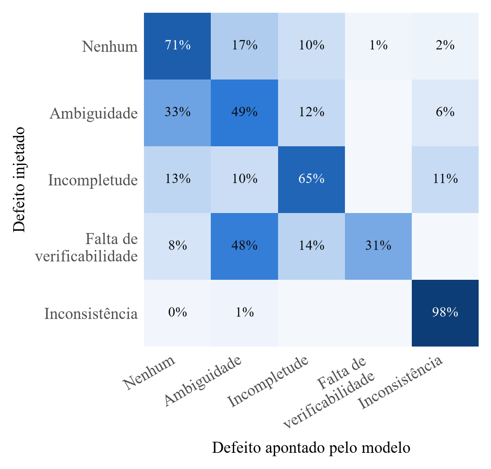
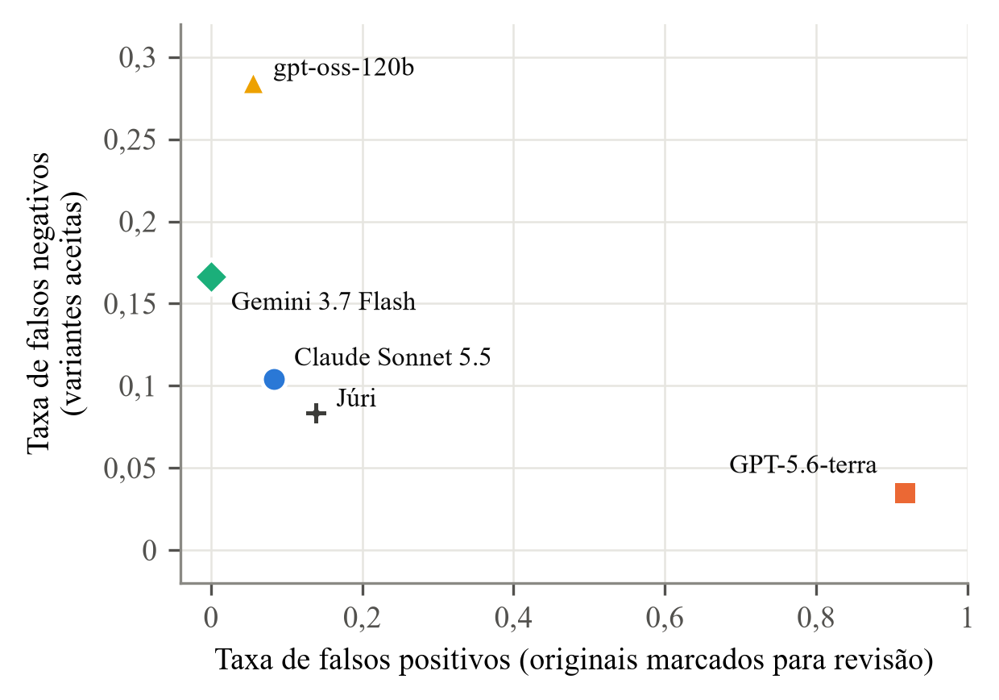
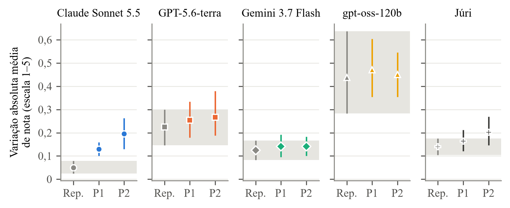

# Além da concordância

**Uma avaliação da robustez de modelos de linguagem na análise da qualidade de requisitos de software**

LLMs são cada vez mais usados como juízes automáticos de artefatos de software. Este projeto testa duas coisas:
o modelo **acerta o defeito que de fato existe** num requisito? E **mantém o julgamento** quando só a apresentação do texto muda?

Para isso, montamos um benchmark controlado. Cada requisito-base ganha variantes com um **defeito-alvo injetado**.
O gabarito é operacional, mas ainda precisa de validação independente para descartar defeitos adicionais.

📄 **Artigo atualizado:** [versão em Markdown](docs/artigo_completo.md) · [fonte LaTeX (modelo SBC)](docs/latex/artigo.tex). O PDF versionado foi gerado antes destas correções e deve ser exportado novamente antes da submissão.

---

## Principais resultados

| | Claude Sonnet 5.5 | GPT-5.6-terra | Gemini 3.7 Flash | gpt-oss-120b | Júri |
| --- | :---: | :---: | :---: | :---: | :---: |
| Especificidade (originais aceitos) | 0,92 | **0,08** | **1,00** | 0,94 | 0,86 |
| Taxa de falsos negativos | 0,10 | **0,04** | 0,17 | 0,29 | 0,08 |
| Macro-F1 (5 classes) | 0,64 | 0,56 | **0,68** | 0,49 | **0,68** |
| Mesma decisão nas 3 repetições | **100%** | 93% | 97% | 88% | 97% |

- **Perceber o defeito é mais fácil do que nomeá-lo.** A inconsistência foi rotulada corretamente em ~100% dos casos. A falta de verificabilidade foi chamada de "ambiguidade" em 48% das respostas, somando modelos e condições.
- **A ambiguidade é a dimensão mais difícil:** teve a menor queda de nota, a menor concordância entre modelos e 33% das variantes ambíguas foram aceitas sem defeito.
- **O rigor varia muito.** O GPT-5.6-terra pediu revisão de 92% dos requisitos *corretos*. O gpt-oss-120b foi o oposto e deixou passar defeitos.
- **Mudanças superficiais afetam pouco em média**, mas a comparação pareada com o ruído mostra efeito na nota do Claude em P1/P2 e do júri em P2.
- **O júri oferece um compromisso entre métricas**, mas herda parte do viés do juiz mais severo.

<p align="center">
  
  
</p>
<p align="center">
  
</p>

---

## Como funciona

```
12 requisitos-base (app de tarefas "TaskFlow")
 └─ cada um: 1 original + 4 variantes com um defeito-alvo
      ambiguidade · incompletude · falta de verificabilidade · inconsistência
          = 60 itens
              × 5 consultas (3 repetições + formatação P1 + ordem P2)
              × 4 modelos (via OpenRouter)
          = 1.200 julgamentos  →  + júri (agregação, sem chamadas extras)
```

Cada modelo devolve um JSON com notas de 1 a 5 em **completude, ausência de ambiguidade, verificabilidade e consistência**
(ISO/IEC/IEEE 29148:2018), o defeito principal e a decisão *aceitar/revisar*. Os intervalos de confiança de 95% vêm de bootstrap sobre os requisitos-base.

| Pergunta | O que mede |
| --- | --- |
| **RQ1** Sensibilidade | detecção do defeito, especificidade, macro-F1, queda de nota no critério afetado |
| **RQ2** Robustez | mudança causada por P1/P2 **menos o ruído entre repetições idênticas, nos mesmos itens** |
| **RQ3** Júri | as mesmas métricas para o júri; concordância entre modelos (α de Krippendorff) |
| **RQ4** Dificuldade | ranking das quatro dimensões |

---

## Estrutura

```
benchmark/
├── corpus_requisitos.csv     # 60 itens com defeito injetado e gabarito
├── run_benchmark.py          # envia os itens aos modelos (só stdlib, retomável)
├── analise.py                # métricas, júri, IC bootstrap → resultados/
├── graficos.ipynb            # figuras do artigo
├── config.json               # modelos e parâmetros usados
├── respostas_brutas/         # 1 .jsonl por modelo, com a resposta original
└── resultados/               # tabelas CSV + resumo.md
docs/
├── artigo_completo.md
└── latex/                    # artigo.tex, referencias.bib, figuras/, artigo.pdf
```

## Reproduzir

```bash
cd benchmark
pip install pandas numpy matplotlib

# Reproduzir as tabelas a partir das respostas já coletadas: sem chave e sem custo de API
python analise.py --raw respostas_brutas --corpus corpus_requisitos.csv --out resultados
jupyter nbconvert --to notebook --execute --inplace graficos.ipynb
```

Uma **nova coleta** é opcional e exige `OPENROUTER_API_KEY`. Confira preços e IDs dos modelos antes de executar `python run_benchmark.py --config config.json --dry-run` e, depois, a execução completa. Não misture uma nova coleta às respostas originais sem versionar os resultados.

Para só refazer a análise, as respostas brutas já estão no repositório e não é preciso chave. A coleta original custou **cerca de US$ 2** em créditos do OpenRouter, pelos preços de novembro de 2026; isso não é uma estimativa de preço atual.

| Modelo | ID no OpenRouter | Temperatura |
| --- | --- | :---: |
| Claude Sonnet 5.5 | `anthropic/claude-sonnet-5.5` | 0 |
| GPT-5.6-terra | `openai/gpt-5.6-terra` | — (raciocínio baixo) |
| Gemini 3.7 Flash | `google/gemini-3.7-flash` | 0 |
| gpt-oss-120b | `openai/gpt-oss-120b` | 0 |

Coleta feita em 15 e 16/11/2026. Modelos proprietários mudam com o tempo, então os resultados valem para essas versões e datas.

---

## Limitações

Só 12 requisitos-base, então os intervalos de confiança são largos. O estudo usa um domínio, um idioma (inglês) e uma redação de prompt.
O corpus foi rascunhado com apoio de um LLM da mesma família de um dos juízes e ainda não recebeu validação independente do gabarito. B06-AMB, B07-AMB e B11-AMB precisam de adjudicação antes da submissão. Há 14 respostas individuais com rótulo de defeito e decisão “aceitar”; a análise expõe acerto do rótulo e acerto estrito separadamente. Detalhes na seção *Ameaças à validade* do artigo e no [protocolo de revisão do corpus](benchmark/REVISAO_CORPUS.md).

## Licença

- **Código** (`*.py`, notebook, LaTeX): [MIT](LICENSE)
- **Dados e texto** (corpus, respostas brutas, resultados, artigo e figuras): [CC BY 4.0](LICENSE-DATA)
