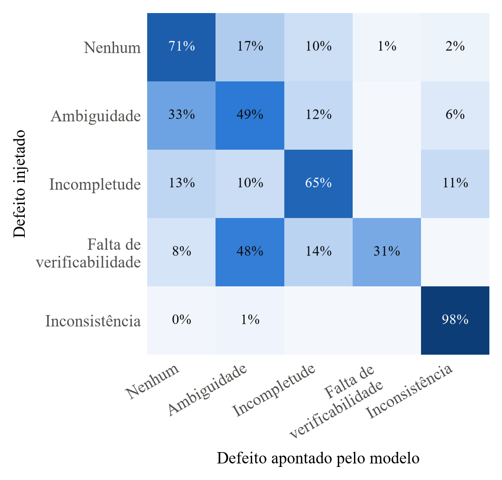
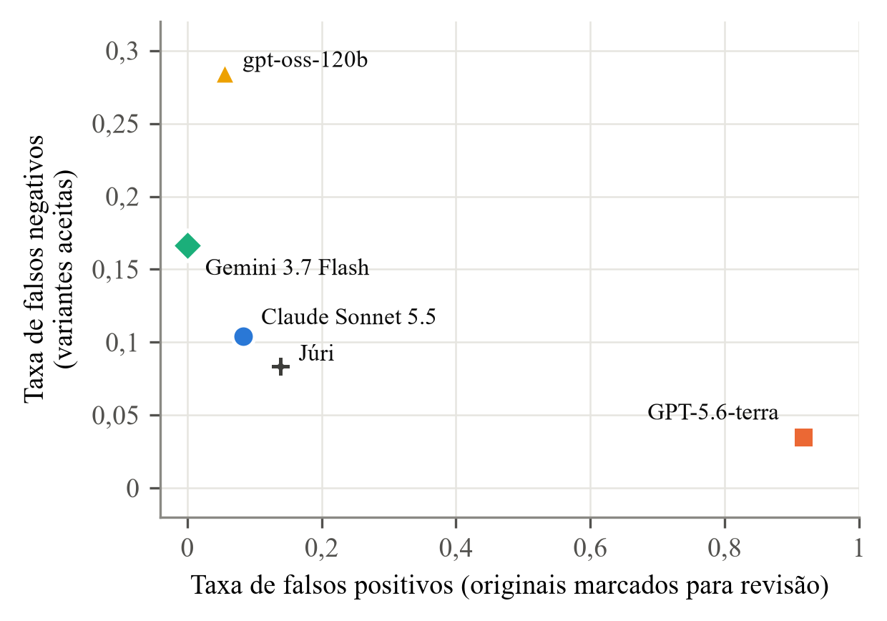
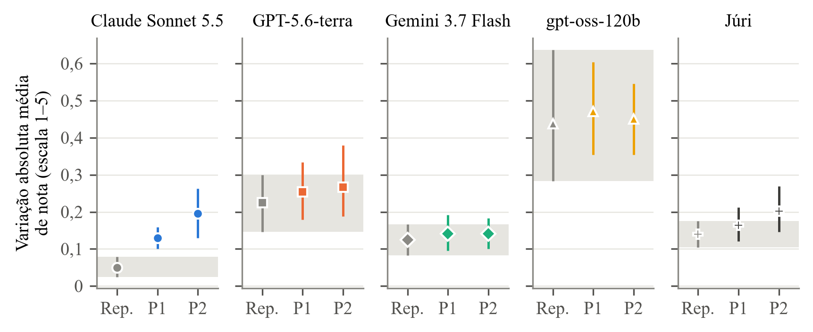
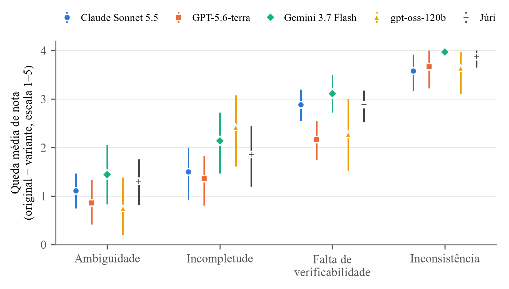

# Além da concordância: uma avaliação da robustez de modelos de linguagem na análise da qualidade de requisitos de software

*[Autores] — [Instituição] — [e-mails]*

## Resumo

Modelos de linguagem (LLMs) já são investigados como avaliadores da qualidade de requisitos, mas ainda é importante testar se seus julgamentos acompanham defeitos introduzidos de forma controlada e resistem a mudanças superficiais na apresentação. Este artigo apresenta um benchmark com 12 requisitos-base de um aplicativo de tarefas, cada um acompanhado de quatro variantes com um defeito-alvo injetado (ambiguidade, incompletude, falta de verificabilidade ou inconsistência). Quatro LLMs de três famílias e um júri formado por eles avaliaram os 60 itens sob repetição e duas perturbações superficiais, totalizando 1.200 julgamentos individuais. Os modelos marcaram para revisão a maior parte das variantes, mas nomearam corretamente o defeito-alvo com menos frequência: a inconsistência foi rotulada corretamente em quase 100% dos casos, enquanto a falta de verificabilidade foi rotulada como ambiguidade em 48% das respostas nas cinco condições. O rigor variou muito: um modelo pediu revisão de 92% dos originais. Na comparação pareada com o ruído entre repetições, o efeito das perturbações sobre a nota apareceu no Claude e, para a mudança de ordem, no júri. Os resultados indicam utilidade para triagem, mas não dispensam revisão humana do diagnóstico nem validação independente do gabarito.

**Palavras-chave:** engenharia de requisitos; qualidade de requisitos; LLM-as-a-Judge; robustez; júri de modelos.

## Abstract

Large language models (LLMs) have already been studied as requirements-quality evaluators, but their response to controlled defects and superficial presentation changes remains important to test. This paper presents a benchmark with 12 base requirements of a to-do application, each paired with four variants containing a target injected defect (ambiguity, incompleteness, non-verifiability or inconsistency). Four LLMs from three model families, and a jury aggregating them, evaluated the 60 items under repetition and two surface perturbations, for 1,200 individual judgments. The models flagged most variants for revision but named the target defect correctly less often: inconsistency was labeled correctly almost always, whereas non-verifiability was labeled as ambiguity in 48% of responses across all five conditions. Strictness varied widely: one model asked to revise 92% of the originals. In a paired comparison against repeat-run noise, the score effect appeared for Claude and, under reordered context, for the jury. LLMs may support triage, but human review of the diagnosis and independent validation of the answer key remain necessary.

**Keywords:** requirements engineering; requirements quality; LLM-as-a-Judge; robustness; LLM jury.

## 1. Introdução

Modelos de linguagem vêm sendo aplicados em diversas atividades da Engenharia de Requisitos (ER), sobretudo na elicitação, na geração e na transformação de requisitos [Marques et al. 2024; Silva et al. 2025]. Mais recentemente, passaram a atuar também como avaliadores automáticos, no paradigma conhecido como *LLM-as-a-Judge*: o modelo recebe um artefato e atribui notas, escolhe entre alternativas ou aprova o conteúdo.

A literatura já mostra que juízes LLM favorecem a fluência e a verbosidade [Zhou et al. 2024], são sensíveis à escala de pontuação [Fujinuma 2025] e aceitam bem respostas válidas, mas rejeitam mal as inválidas [Jain et al. 2025]. Para requisitos de software, isso levanta duas questões práticas. A primeira é se o modelo identifica o defeito que realmente existe no requisito, e não apenas se concorda com outro avaliador. A segunda é se o julgamento se mantém quando só a apresentação muda, por exemplo quando o texto chega formatado de outro modo.

Este trabalho investiga essas questões com um benchmark controlado. Para cada requisito-base considerado correto pelos autores, são criadas variantes com um defeito-alvo deliberado. Isso fornece um gabarito operacional sem tratar a avaliação humana como padrão-ouro perfeito [Nordin et al. 2017], mas não garante que cada item contenha apenas uma falha; essa hipótese exige validação independente. A pergunta de pesquisa é: *como diferentes LLMs identificam defeitos de qualidade em requisitos de software e quão robustos são seus julgamentos diante de repetições e de alterações superficiais no texto?* Ela se desdobra em quatro subperguntas:

- **RQ1.** Quão sensíveis são diferentes LLMs a defeitos específicos de qualidade em requisitos?
- **RQ2.** A avaliação permanece consistente quando somente a formatação ou a ordem do contexto são alteradas?
- **RQ3.** Um júri de múltiplos LLMs é mais robusto do que um modelo individual?
- **RQ4.** Quais dimensões de qualidade são mais difíceis de avaliar?

As contribuições são: (i) um corpus de 60 itens com defeitos-alvo injetados e gabarito operacional explícito; (ii) um protocolo replicável que compara o efeito de perturbações ao ruído entre repetições nos mesmos itens; e (iii) uma comparação empírica entre quatro LLMs de três famílias e um júri. Corpus, prompts, scripts e respostas brutas são disponibilizados para replicação.

## 2. Trabalhos relacionados

**Qualidade de requisitos.** A norma ISO/IEC/IEEE 29148:2018 define as características esperadas de um requisito, como ser não ambíguo, completo, verificável e consistente. Montgomery et al. (2022) mapearam 105 estudos e identificaram ambiguidade, completude, consistência e correção como os atributos mais estudados. Sahu et al. (2024) operacionalizaram as características da norma em um framework de processamento de linguagem natural, e Glinz (2000) é a formulação clássica dessas qualidades. Nordin et al. (2017) mostram que o julgamento de especialistas humanos também é inconsistente, o que motiva o uso de um gabarito derivado de alterações controladas.

**LLMs na Engenharia de Requisitos.** Revisões recentes mostram a expansão do uso de LLMs em todas as fases da ER, com predominância de tarefas de geração e lacunas na validação dos artefatos [Marques et al. 2024; Silva et al. 2025]. Almeida et al. (2025) observaram dificuldades com ambiguidade na extração de requisitos a partir de entrevistas, e Pasquale et al. (2025) relatam o uso de LLMs na especificação funcional em um projeto real, sob supervisão humana. Yamani et al. (2025) encontraram inconsistências entre os valores declarados por 23 LLMs e o seu comportamento em tarefas de ER.

**LLM-as-a-Judge.** Juízes LLM tendem a favorecer a qualidade superficial [Zhou et al. 2024], variam com a faixa de notas do prompt [Fujinuma 2025] e rejeitam mal respostas inválidas, com taxa de verdadeiros negativos abaixo de 25% em alguns cenários [Jain et al. 2025]. Badshah e Sajjad (2024) propõem vereditos guiados por referência, e Li et al. (2025a) defendem calibrar avaliadores para distribuições de preferência.

**Júris e decision models.** Verga et al. (2024) mostraram que um painel de modelos menores, de famílias diferentes, supera um juiz grande a um custo mais de sete vezes menor. Trabalhos posteriores propõem destilar o júri [Tang et al. 2025], selecionar juízes por instância [Li et al. 2025b] ou por similaridade [Yang 2025]. Williams et al. (2025), por outro lado, encontraram ganho do júri em apenas um de onze critérios clínicos. Li et al. (2026) avaliam um decision model que retorna vereditos com probabilidades a uma fração do custo, mas com perdas em respostas incorretas bem redigidas.

**Posicionamento e lacuna.** A avaliação de qualidade de requisitos por LLMs não é inédita. Shefa et al. (2026) comparam dez modelos com um gabarito de especialistas, dois conjuntos de requisitos, repetições e temperaturas; Paiva et al. (2026) usam um juiz LLM para atributos da ISO 29148 em requisitos gerados de títulos de issues. Nosso diferencial é combinar pares original–variante com defeito-alvo, duas mudanças de apresentação, comparação pareada com ruído e um júri de modelos. A Tabela 0 delimita essa contribuição; ela não estabelece superioridade metodológica nem dispensa a validação humana do corpus.

**Tabela 1 – Posicionamento frente aos estudos mais próximos**

| Estudo | Desenho da avaliação | Diferença deste estudo |
| --- | --- | --- |
| Shefa et al. (2026) | Dez LLMs; gabarito de especialistas; dois conjuntos de requisitos; repetições e temperaturas. | Pares original–variante, perturbações de apresentação e júri. |
| Paiva et al. (2026) | Requisitos gerados de títulos de issues; juiz LLM com atributos da ISO 29148; validação humana amostral. | Foco na confiabilidade do avaliador, não na qualidade da geração. |
| Este estudo | 12 requisitos-base, 48 variantes, quatro modelos, duas perturbações e júri. | Separa sinal de defeito, decisão de revisão e estabilidade, em um domínio sintético. |

## 3. Metodologia

### 3.1 Corpus

O corpus descreve o TaskFlow, um aplicativo web de lista de tarefas. São 12 requisitos-base redigidos em inglês como enunciados de requisitos, cobrindo criação, conclusão e edição de tarefas, lembretes, listas, lixeira, ordenação, busca, bloqueio de login, compartilhamento, desempenho e exclusão de conta. Cada base tem quatro variantes com um defeito-alvo injetado (Tabela 2), totalizando 60 itens.

**Tabela 2 – Defeitos injetados**

| Defeito | Critério afetado | Como é introduzido |
| --- | --- | --- |
| Ambiguidade | Ausência de ambiguidade | Construção com duas interpretações razoáveis |
| Incompletude | Completude | Remoção de limites, condições ou comportamento de erro |
| Falta de verificabilidade | Verificabilidade | Troca de um critério mensurável por termo subjetivo |
| Inconsistência | Consistência | Contradição com uma regra do contexto |

Cada item vem acompanhado de uma descrição curta do sistema e de uma a três regras relacionadas, idênticas nas cinco versões de uma base. O padrão esperado é operacional: o original deve receber nota 4 ou 5 em todos os critérios e a decisão "aceitar"; a variante deve receber nota 1 ou 2 no critério afetado e a decisão "revisar". Uma execução-piloto revelou contradições ou omissões em três bases (B03, B04 e B05) em relação às regras do contexto; elas foram corrigidas nas cinco versões antes da coleta final.

### 3.2 Rubric e prompt

Os modelos avaliam cada requisito em quatro critérios, com notas inteiras de 1 a 5: completude, ausência de ambiguidade, verificabilidade e consistência [ISO/IEC/IEEE 2018; Montgomery et al. 2022; Sahu et al. 2024]. Também informam o defeito principal, a decisão (aceitar ou revisar) e uma justificativa de até duas frases. Todos os modelos recebem o mesmo prompt de sistema, que trata o texto do requisito como dado, e devolvem um objeto JSON. O identificador mostrado ao modelo é neutro (REQ-001 a REQ-060, sorteado com semente fixa), para não revelar o tipo de variante.

### 3.3 Modelos e condições

Foram avaliados quatro modelos de três famílias (Anthropic, Google e OpenAI), todos acessados pelo OpenRouter em 15 e 16 de novembro de 2026 (Tabela 3). GPT-5.6-terra e gpt-oss-120b são contados separadamente como modelos, mas pertencem à mesma família de fornecedor.

**Tabela 3 – Modelos avaliados**

| Modelo | Identificador | Temperatura | Raciocínio |
| --- | --- | --- | --- |
| Claude Sonnet 5.5 | `anthropic/claude-sonnet-5.5` | 0 | padrão |
| GPT-5.6-terra | `openai/gpt-5.6-terra` | não aceita | esforço baixo |
| Gemini 3.7 Flash | `google/gemini-3.7-flash` | 0 | esforço baixo |
| gpt-oss-120b (aberto) | `openai/gpt-oss-120b` | 0 | esforço baixo |

Cada item foi consultado cinco vezes por modelo: três repetições na apresentação original (P0), uma com formatação em Markdown (P1) e uma com o requisito antes do contexto e as regras em ordem inversa (P2). As perturbações preservam o significado. O júri agrega as respostas individuais sem novas chamadas: a nota é a mediana; a decisão é "revisar" se pelo menos metade dos modelos pedir revisão; o defeito é o mais votado.

### 3.4 Métricas

Para RQ1: acerto do rótulo (defeito apontado igual ao injetado, independentemente da decisão), acerto estrito (rótulo correto **e** decisão “revisar”), proporção de variantes marcadas para revisão, especificidade (originais aceitos), macro-F1 em cinco classes, queda de nota no critério afetado (original menos variante) e erro em relação à faixa esperada. Para RQ2: concordância entre as três repetições (decisão, defeito e alfa de Krippendorff) e variação absoluta de nota e taxa de troca de decisão entre P0 e P1 e entre P0 e P2. Para cada item, a diferença entre a mudança sob P1/P2 e o ruído P0-repetição 1 versus P0-repetição 2 é agregada por requisito-base; um IC da diferença que não inclua zero sugere efeito distinguível do ruído sob este protocolo. Para RQ3: as mesmas métricas para o júri e alfa de Krippendorff entre modelos. Para RQ4: ordenação das dimensões pela queda de nota. Os intervalos de confiança de 95% são obtidos por bootstrap percentil (2.000 reamostragens) sobre os 12 requisitos-base, a unidade independente.

## 4. Resultados

As 1.200 respostas foram válidas, sem falhas técnicas após as novas tentativas automáticas. Valores entre colchetes são IC 95%.

### 4.1 RQ1: sensibilidade aos defeitos

**Os modelos percebem o problema com mais facilidade do que o nomeiam.** Em inconsistência e falta de verificabilidade, Claude, GPT-5.6-terra e Gemini marcaram para revisão entre 94% e 100% das variantes; em incompletude, todos os modelos ficaram entre 81% e 92%. A ambiguidade foi a exceção: 75% no Claude, 56% no Gemini e 33% [11%; 58%] no gpt-oss-120b. O acerto do rótulo variou muito por defeito (Figura 1). Essa figura e o macro-F1 usam o rótulo, não a decisão. Em 14 das 1.200 respostas individuais, houve rótulo de defeito junto com a decisão “aceitar” (10 em P0); por isso, a tabela de sensibilidade também apresenta o acerto estrito, que exige “revisar”.

A falta de verificabilidade teve o maior descompasso: os modelos quase sempre pediram revisão, mas, somando os quatro modelos e as cinco condições, 48% das respostas rotularam o defeito como ambiguidade e só 31% como falta de verificabilidade (Figura 2). Termos como "rapidamente" e "amigável" são lidos como ambíguos, o que aponta uma fronteira pouco nítida entre os dois rótulos no rubric. Por outro lado, 33% das respostas às variantes ambíguas não apontaram defeito algum nesse mesmo conjunto de condições. As demais métricas de RQ1 usam apenas P0.

**O calibre de exigência varia muito entre modelos (Figura 3).** Gemini (especificidade 1,00), gpt-oss-120b (0,94) e Claude (0,92) aceitaram quase todos os originais. O GPT-5.6-terra pediu revisão de 92% deles (especificidade 0,08 [0,00; 0,17]), apontando lacunas menores, como o ponto de início da contagem de um limite de 2 segundos, em geral rotuladas como ambiguidade. Esse maior rigor acompanha seu maior acerto do rótulo de ambiguidade (0,81), mas não demonstra uma relação causal. O gpt-oss-120b fica no extremo oposto, com a maior taxa de falsos negativos (0,29). O macro-F1 foi maior no Gemini (0,68) e no júri (0,68), seguidos de Claude (0,64), GPT-5.6-terra (0,56) e gpt-oss-120b (0,49).

Todos os modelos reduziram a nota no critério afetado (Figura 5). No erro em relação à faixa esperada, o Claude teve o menor valor (MAE 0,21 [0,13; 0,30]), seguido do júri (0,25); o gpt-oss-120b teve o maior (0,48), concentrado em ausência de ambiguidade.

### 4.2 RQ2: robustez a mudanças superficiais

O Claude foi o mais estável entre repetições: mesma decisão em 100% dos itens, mesmo defeito em 98% e alfa de 0,98. Seguiram-se Gemini (decisão 97%; alfa 0,97), GPT-5.6-terra (93%; 0,90) e gpt-oss-120b (88%; 0,83), este último com o mesmo defeito em só 75% dos itens, apesar da temperatura 0.

As perturbações mudaram a nota em menos de 0,5 ponto em média (Figura 4). No contraste pareado por requisito-base, a diferença média entre a variação sob perturbação e o ruído ficou acima de zero para Claude em P1 (0,079; IC 95% [0,054; 0,108]) e P2 (0,146; [0,092; 0,204]), e para o júri em P2 (0,063; [0,021; 0,106]). Para GPT-5.6-terra, Gemini e gpt-oss-120b, os intervalos das diferenças incluem zero. Esses resultados são exploratórios com apenas 12 bases e não equivalem a afirmar ausência de efeito nos demais modelos. A troca de decisão sob P2 no Claude excedeu o ruído em 0,083 [0,017; 0,167].

### 4.3 RQ3: júri × modelos individuais

O júri não superou o melhor modelo, mas ficou perto dele em todas as métricas. Empatou com o Gemini no maior macro-F1 (0,68), teve o segundo menor erro em relação à faixa esperada (0,25) e uma taxa de falsos negativos (0,08) que é metade da do Gemini (0,17). Também neutralizou o modelo menos estável: sua variação de nota entre repetições (0,14) é um terço da do gpt-oss-120b (0,44). Em contrapartida, a especificidade do júri (0,86) ficou abaixo da de três modelos individuais, porque, com quatro juízes, dois votos bastam para "revisar" e o GPT-5.6-terra vota assim quase sempre.

A concordância entre modelos foi de 0,74 (alfa de Krippendorff), alta em consistência (0,89) e baixa em ausência de ambiguidade (0,57). O custo total foi de cerca de US$ 2,00 pelos preços de tabela (Claude ≈ US$ 0,97; GPT-5.6-terra ≈ 0,74; Gemini ≈ 0,26; gpt-oss-120b ≈ 0,05), e a latência média ficou entre 1,5 s e 3,2 s por chamada. O júri não exige chamadas extras; seu custo é a soma dos modelos.

### 4.4 RQ4: dimensões mais difíceis

A queda média de nota no critério afetado ordena as dimensões da mais difícil para a mais fácil: ambiguidade (1,04), incompletude (1,85), falta de verificabilidade (2,61) e inconsistência (3,72) (Figura 5). A inconsistência com regras explícitas do contexto foi detectada e rotulada em quase todos os casos, com a maior concordância entre modelos. A ambiguidade teve a menor queda, a menor concordância e a menor proporção de variantes marcadas para revisão. A falta de verificabilidade combina queda grande com detecção exata baixa: o problema é percebido, mas recebe outro nome.

## 5. Discussão

**Triagem sim, diagnóstico com cautela.** Neste corpus sintético, alguns modelos separaram bem variantes de originais segundo o gabarito operacional; o desempenho dependeu fortemente do modelo. O diagnóstico do tipo de defeito foi menos confiável, exceto quando houve contradição com regra explícita. Para uso prático, isso sugere testar LLMs como filtro de primeira passagem, com o diagnóstico final feito por um analista e validação em dados reais.

**Concordância não é acerto.** O achado de Jain et al. (2025), de que juízes aceitam bem e rejeitam mal, não se repetiu de forma uniforme: aqui, um modelo rejeitou quase tudo e outro aceitou demais. O ponto em comum é que o calibre de cada modelo precisa ser medido com pares correto/defeituoso, e não inferido da concordância com outros juízes.

**O júri herda o viés do mais severo.** Diferentemente do ganho relatado por Verga et al. (2024), o júri aqui ficou perto do melhor modelo sem superá-lo, em linha com Williams et al. (2025). A regra de agregação importa: com um juiz muito severo, uma maioria simples de "pelo menos metade" desloca o júri para falsos positivos. Excluir o juiz descalibrado ou exigir maioria estrita são alternativas a testar.

**A taxonomia pesa.** A troca frequente entre "ambiguidade" e "falta de verificabilidade" sugere que parte da dificuldade está nos rótulos, e não na percepção dos modelos. Um rubric com exemplos de fronteira entre essas categorias pode melhorar a detecção exata.

**LLMs como revisores do próprio benchmark.** Na execução-piloto, os modelos apontaram contradições reais em três requisitos que a equipe considerava corretos. Esse episódio ilustra o uso mais promissor observado: um segundo par de olhos que encontra o que passou despercebido, e não um árbitro final.

## 6. Ameaças à validade

**Validade interna.** O corpus foi construído pelos pesquisadores, com apoio de um LLM da mesma família de um dos juízes (Claude), o que pode favorecê-lo. Três bases foram corrigidas após a execução-piloto; a correção se limitou a contradições e omissões objetivas em relação às regras do contexto. As variantes incompletas são mais curtas por construção. **Validade de construto.** O gabarito é operacional, não foi validado por avaliadores independentes e assume que cada variante tem só o defeito-alvo. Uma auditoria prévia levantou dúvidas específicas em B07-AMB e B11-AMB (possível incompletude junto à ambiguidade) e B06-AMB; elas devem ser adjudicadas antes da submissão, sem alterar retroativamente a coleta. A sobreposição entre ambiguidade e falta de verificabilidade também mostra que a taxonomia não é perfeitamente separável. **Validade de conclusão.** Com 12 requisitos-base, os intervalos são largos, e múltiplos contrastes foram examinados sem ajuste formal para multiplicidade; os resultados inferenciais são exploratórios. **Validade externa.** Um único domínio, idioma (inglês) e redação de prompt foram usados, e todos os modelos foram acessados por um único intermediário. Modelos proprietários mudam com o tempo; os resultados valem para as versões e datas registradas.

## 7. Conclusão

Este trabalho apresentou um benchmark controlado para avaliar LLMs como juízes da qualidade de requisitos. Os quatro modelos avaliados perceberam a maioria dos defeitos-alvo, mas nomearam corretamente o rótulo com frequência bem menor, exceto em inconsistências explícitas. A ambiguidade foi a dimensão mais difícil. O rigor variou do excesso de exigência ao excesso de aceitação. Mudanças superficiais tiveram efeito pequeno em média, mas distinguível do ruído no Claude e, para P2, no júri. O júri ofereceu um compromisso entre métricas, sem dominar todos os modelos individuais.

Como trabalhos futuros, propõem-se: ampliar o corpus para outros domínios e idiomas; testar variações de prompt e rubrics com exemplos de fronteira entre categorias; avaliar regras de agregação do júri e júris dinâmicos [Li et al. 2025b]; incluir decision models como o Jev [Li et al. 2026]; e estudar avaliadores humanos para comparar o calibre dos modelos com o de analistas.

**Disponibilidade.** Corpus, prompts, configuração, scripts, respostas brutas e notebook de gráficos estão na pasta `benchmark/` do repositório do projeto.

## Referências

Almeida, C., Copque, I., Oliveira, A., Arouca, M., Barbosa, A., Freire, S., Mendonça, M., and Leite, J. C. (2025). From Elicitation Interviews to Software Requirements: Evaluating LLM Performance in Requirement Generation. In *Proceedings of WER 2025*. DOI: 10.29327/1588952.28-12.

Badshah, S., and Sajjad, H. (2024). Reference-Guided Verdict: LLMs-as-Judges in Automatic Evaluation of Free-Form QA. arXiv:2408.09235.

Fujinuma, Y. (2025). Contrastive Decoding Mitigates Score Range Bias in LLM-as-a-Judge. arXiv:2510.18196.

Glinz (2000). Improving the quality of requirements with scenarios. In *Proc. 2nd World Congress for Software Quality (2WCSQ)*, Yokohama, p. 55–60.

ISO/IEC/IEEE (2018). ISO/IEC/IEEE 29148:2018 – Systems and software engineering – Life cycle processes – Requirements engineering. DOI: 10.1109/IEEESTD.2018.8559686.

Jain, S., Ahmed, U. Z., Sahai, S., and Leong, B. (2025). Beyond Consensus: Mitigating the Agreeableness Bias in LLM Judge Evaluations. arXiv:2510.11822.

Li, Li and Huang (2025a). Judging with confidence: calibrating autoraters to preference distributions. arXiv:2510.00263.

Li, X., Wang, K., Gouda, G., et al. (2025b). Who Judges the Judge? LLM Jury-on-Demand: Building Trustworthy LLM Evaluation Systems. arXiv:2512.01786.

Li, Y., Miao, Y., Krishnan, R., and Padman, R. (2026). JEV-as-a-Judge: Accept When Confident, Escalate When Unsure. arXiv:2609.26550 (preprint).

Marques, Silva and Bernardino (2024). Using ChatGPT in software requirements engineering: a comprehensive review. *Future Internet*, 16(6), 180. DOI: 10.3390/fi16060180.

Montgomery, Fucci and Bouraffa (2022). Empirical research on requirements quality: a systematic mapping study. *Requirements Engineering*, 27, 183–209. DOI: 10.1007/s00766-021-00367-z.

Nordin, A., Ahmad Zaidi, N. H., and Mazlan, N. A. (2017). Measuring Software Requirements Specification Quality. *Journal of Telecommunication, Electronic and Computer Engineering*, 9(3-5), 123–128.

Paiva, G., Canedo, E. D., and Rocha Filho, G. P. (2026). From issue titles to requirements: an empirical study of large language models and prompt engineering strategies. *Requirements Engineering*, 31, article 7. DOI: 10.1007/s00766-026-00462-z.

Pasquale, L., Ragone, A., Piemontese, E., and Darban, A. A. (2025). Exploring the Use of LLMs for Requirements Specification in an IT Consulting Company. In *Proc. IEEE RE 2025*, pp. 389–399. DOI: 10.1109/RE63999.2025.00045.

Sahu, C. K., Rai, V., and Roshan, V. (2024). Well-Formed Quality of System Requirements for Verifying to ISO 29148-2018: A Natural Language Processing (NLP) Based Framework and Quantitative Metric. In *Proc. ASME IDETC-CIE 2024*. DOI: 10.1115/DETC2024-139583.

Shefa, J., Salado, A., Wach, P., and Topcu, T. G. (2026). Two Truths and A Lie? Benchmarking Off-the-Shelf LLMs for Requirements Quality Assessment: Performance, False Alarms, and Misses. arXiv:2609.03230 (preprint). DOI: 10.48550/arXiv.2609.03230.

Silva, Y., Gois, M., Santos, A., Castro, J., and Lencastre, M. (2025). Uso de Large Language Models na Engenharia de Requisitos. In *Proceedings of WER 2025*. DOI: 10.29327/1588952.28-18.

Tang, Y., Feng, K., Wang, Y., et al. (2025). Learning an Efficient Multi-Turn Dialogue Evaluator from Multiple LLM Judges. arXiv:2508.00454.

Verga, Hofstatter, Althammer et al. (2024). Replacing judges with juries: evaluating LLM generations with a panel of diverse models. arXiv:2404.18796.

Williams, G., Rutunda, S., Nzabakira, F., and Mateen, B. A. (2025). Human Evaluators vs. LLM-as-a-Judge: Toward Scalable, Real-Time Evaluation of GenAI in Global Health. *medRxiv* (preprint). DOI: 10.1101/2025.10.27.25338910.

Yamani, A., Baslyman, M., and Ahmed, M. (2025). Are We Aligned? A Preliminary Investigation of the Alignment of Responsible AI Values between LLMs and Human Judgment. In *Proc. AIware 2025*, pp. 133–142. DOI: 10.1109/AIware69974.2025.00022.

Yang, Z. (2025). LLM Evaluation Panel Selection Based on Cross Assessment and Similarity Matrix. DOI: 10.65286/icic.v21i4.11558.

Zhou, H., Huang, H., Long, Y., et al. (2024). Mitigating the Bias of Large Language Model Evaluation. arXiv:2409.16788.

*Antes da submissão, conferir a normalização final das referências conforme as normas do evento e revisar os metadados que não tenham sido extraídos diretamente da editora.*
