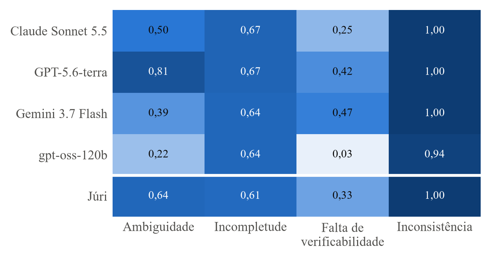

# Além da concordância: uma avaliação da robustez de modelos de linguagem na análise da qualidade de requisitos de software

*[Autores] — [Instituição] — [e-mails]*

## Resumo

Modelos de linguagem (LLMs) têm sido usados como juízes automáticos da qualidade de artefatos de software, mas pouco se sabe se identificam o defeito que de fato existe em um requisito e se mantêm o julgamento quando apenas a apresentação do texto muda. Este artigo apresenta um benchmark controlado com 12 requisitos-base de um aplicativo de tarefas, cada um acompanhado de quatro variantes com um único defeito injetado (ambiguidade, incompletude, falta de verificabilidade ou inconsistência). Quatro LLMs de famílias distintas e um júri formado por eles avaliaram os 60 itens sob repetição e duas perturbações superficiais, totalizando 1.200 julgamentos. Os modelos marcaram para revisão a maior parte das variantes defeituosas, mas nomearam corretamente o defeito com bem menos frequência: a inconsistência foi detectada em quase 100% dos casos, enquanto a falta de verificabilidade foi rotulada como ambiguidade em 48% das respostas. O calibre de exigência variou muito entre modelos: um deles pediu revisão de 92% dos requisitos corretos. Perturbações de formatação e de ordem tiveram efeito pequeno, distinguível do ruído apenas no modelo mais estável. O júri ficou próximo do melhor modelo em cada métrica, sem superá-lo. Os resultados indicam que LLMs são úteis como apoio à triagem de requisitos, mas não substituem a revisão humana na classificação dos defeitos.

**Palavras-chave:** engenharia de requisitos; qualidade de requisitos; LLM-as-a-Judge; robustez; júri de modelos.

## Abstract

Large language models (LLMs) are increasingly used as automatic judges of software artifacts, yet it is unclear whether they identify the defect actually present in a requirement and whether their judgment holds when only the presentation of the text changes. This paper presents a controlled benchmark with 12 base requirements of a to-do application, each paired with four variants containing a single injected defect (ambiguity, incompleteness, non-verifiability or inconsistency). Four LLMs from different families, and a jury aggregating them, evaluated the 60 items under repetition and two surface perturbations, for a total of 1,200 judgments. The models flagged most defective variants for revision but named the defect correctly far less often: inconsistency was detected in almost every case, whereas non-verifiability was labeled as ambiguity in 48% of the answers. Strictness varied widely: one model asked to revise 92% of the correct requirements. Formatting and ordering perturbations had a small effect, distinguishable from noise only for the most stable model. The jury stayed close to the best model on every metric without surpassing it. LLMs are useful for triaging requirements, but they do not replace human review when classifying defects.

**Keywords:** requirements engineering; requirements quality; LLM-as-a-Judge; robustness; LLM jury.

## 1. Introdução

Modelos de linguagem vêm sendo aplicados em diversas atividades da Engenharia de Requisitos (ER), sobretudo na elicitação, na geração e na transformação de requisitos [Marques et al. 2024; Silva et al. 2025]. Mais recentemente, passaram a atuar também como avaliadores automáticos, no paradigma conhecido como *LLM-as-a-Judge*: o modelo recebe um artefato e atribui notas, escolhe entre alternativas ou aprova o conteúdo.

A literatura já mostra que juízes LLM favorecem a fluência e a verbosidade [Zhou et al. 2024], são sensíveis à escala de pontuação [Fujinuma 2025] e aceitam bem respostas válidas, mas rejeitam mal as inválidas [Jain et al. 2025]. Para requisitos de software, isso levanta duas questões práticas. A primeira é se o modelo identifica o defeito que realmente existe no requisito, e não apenas se concorda com outro avaliador. A segunda é se o julgamento se mantém quando só a apresentação muda, por exemplo quando o texto chega formatado de outro modo.

Este trabalho investiga essas questões com um benchmark controlado. Para cada requisito-base correto, são criadas variantes que introduzem um único defeito conhecido. Como o defeito é injetado deliberadamente, a resposta esperada é conhecida de antemão, e o estudo não depende de tratar o julgamento humano como padrão-ouro perfeito [Nordin et al. 2017]. A pergunta de pesquisa é: *como diferentes LLMs identificam defeitos de qualidade em requisitos de software e quão robustos são seus julgamentos diante de repetições e de alterações superficiais no texto?* Ela se desdobra em quatro subperguntas:

- **RQ1.** Quão sensíveis são diferentes LLMs a defeitos específicos de qualidade em requisitos?
- **RQ2.** A avaliação permanece consistente quando somente a formatação ou a ordem do contexto são alteradas?
- **RQ3.** Um júri de múltiplos LLMs é mais robusto do que um modelo individual?
- **RQ4.** Quais dimensões de qualidade são mais difíceis de avaliar?

As contribuições são: (i) um corpus de 60 itens com defeitos controlados e gabarito explícito; (ii) um protocolo replicável que separa o efeito de perturbações do ruído entre repetições; e (iii) uma comparação empírica entre quatro LLMs de famílias distintas e um júri. Corpus, prompts, scripts e respostas brutas são disponibilizados para replicação.

## 2. Trabalhos relacionados

**Qualidade de requisitos.** A norma ISO/IEC/IEEE 29148:2018 define as características esperadas de um requisito, como ser não ambíguo, completo, verificável e consistente. Montgomery et al. (2022) mapearam 105 estudos e identificaram ambiguidade, completude, consistência e correção como os atributos mais estudados. Sahu et al. (2024) operacionalizaram as características da norma em um framework de processamento de linguagem natural, e Glinz (2000) é a formulação clássica dessas qualidades. Nordin et al. (2017) mostram que o julgamento de especialistas humanos também é inconsistente, o que motiva o uso de um gabarito derivado de alterações controladas.

**LLMs na Engenharia de Requisitos.** Revisões recentes mostram a expansão do uso de LLMs em todas as fases da ER, com predominância de tarefas de geração e lacunas na validação dos artefatos [Marques et al. 2024; Silva et al. 2025]. Almeida et al. (2025) observaram dificuldades com ambiguidade na extração de requisitos a partir de entrevistas, e Pasquale et al. (2025) relatam o uso de LLMs na especificação funcional em um projeto real, sob supervisão humana. Yamani et al. (2025) encontraram inconsistências entre os valores declarados por 23 LLMs e o seu comportamento em tarefas de ER.

**LLM-as-a-Judge.** Juízes LLM tendem a favorecer a qualidade superficial [Zhou et al. 2024], variam com a faixa de notas do prompt [Fujinuma 2025] e rejeitam mal respostas inválidas, com taxa de verdadeiros negativos abaixo de 25% em alguns cenários [Jain et al. 2025]. Badshah e Sajjad (2024) propõem vereditos guiados por referência, e Li et al. (2025a) defendem calibrar avaliadores para distribuições de preferência.

**Júris e decision models.** Verga et al. (2024) mostraram que um painel de modelos menores, de famílias diferentes, supera um juiz grande a um custo mais de sete vezes menor. Trabalhos posteriores propõem destilar o júri [Tang et al. 2025], selecionar juízes por instância [Li et al. 2025b] ou por similaridade [Yang 2025]. Williams et al. (2025), por outro lado, encontraram ganho do júri em apenas um de onze critérios clínicos. Li et al. (2026) avaliam um decision model que retorna vereditos com probabilidades a uma fração do custo, mas com perdas em respostas incorretas bem redigidas.

**Lacuna.** Não identificamos, nos trabalhos analisados, um benchmark que introduza defeitos conhecidos em requisitos de software e use esses pares para medir sensibilidade, estabilidade e resistência a perturbações superficiais, comparando juízes individuais e júri.

## 3. Metodologia

### 3.1 Corpus

O corpus descreve o TaskFlow, um aplicativo web de lista de tarefas. São 12 requisitos-base, redigidos em inglês no formato "The system shall...", cobrindo criação, conclusão e edição de tarefas, lembretes, listas, lixeira, ordenação, busca, bloqueio de login, compartilhamento, desempenho e exclusão de conta. Cada base tem quatro variantes, e cada variante introduz um único defeito (Tabela 1), totalizando 60 itens.

**Tabela 1 – Defeitos injetados**

| Defeito | Critério afetado | Como é introduzido |
| --- | --- | --- |
| Ambiguidade | Ausência de ambiguidade | Construção com duas interpretações razoáveis |
| Incompletude | Completude | Remoção de limites, condições ou comportamento de erro |
| Falta de verificabilidade | Verificabilidade | Troca de um critério mensurável por termo subjetivo |
| Inconsistência | Consistência | Contradição com uma regra do contexto |

Cada item vem acompanhado de uma descrição curta do sistema e de uma a três regras relacionadas, idênticas nas cinco versões de uma base. O padrão esperado é operacional: o original deve receber nota 4 ou 5 em todos os critérios e a decisão "aceitar"; a variante deve receber nota 1 ou 2 no critério afetado e a decisão "revisar". Uma execução-piloto revelou contradições ou omissões em três bases (B03, B04 e B05) em relação às regras do contexto; elas foram corrigidas nas cinco versões antes da coleta final.

### 3.2 Rubric e prompt

Os modelos avaliam cada requisito em quatro critérios, com notas inteiras de 1 a 5: completude, ausência de ambiguidade, verificabilidade e consistência [ISO/IEC/IEEE 2018; Montgomery et al. 2022; Sahu et al. 2024]. Também informam o defeito principal, a decisão (aceitar ou revisar) e uma justificativa de até duas frases. Todos os modelos recebem o mesmo prompt de sistema, que trata o texto do requisito como dado, e devolvem um objeto JSON. O identificador mostrado ao modelo é neutro (REQ-001 a REQ-060, sorteado com semente fixa), para não revelar o tipo de variante.

### 3.3 Modelos e condições

Foram avaliados quatro modelos de famílias distintas, todos acessados pelo OpenRouter em 15 e 16 de novembro de 2026 (Tabela 2).

**Tabela 2 – Modelos avaliados**

| Modelo | Identificador | Temperatura | Raciocínio |
| --- | --- | --- | --- |
| Claude Sonnet 5.5 | `anthropic/claude-sonnet-5.5` | 0 | padrão |
| GPT-5.6-terra | `openai/gpt-5.6-terra` | não aceita | esforço baixo |
| Gemini 3.7 Flash | `google/gemini-3.7-flash` | 0 | esforço baixo |
| gpt-oss-120b (aberto) | `openai/gpt-oss-120b` | 0 | esforço baixo |

Cada item foi consultado cinco vezes por modelo: três repetições na apresentação original (P0), uma com formatação em Markdown (P1) e uma com o requisito antes do contexto e as regras em ordem inversa (P2). As perturbações preservam o significado. O júri agrega as respostas individuais sem novas chamadas: a nota é a mediana; a decisão é "revisar" se pelo menos metade dos modelos pedir revisão; o defeito é o mais votado.

### 3.4 Métricas

Para RQ1: detecção exata (defeito apontado igual ao injetado), proporção de variantes marcadas para revisão, especificidade (originais aceitos), macro-F1 em cinco classes, queda de nota no critério afetado (original menos variante) e erro em relação à faixa esperada. Para RQ2: concordância entre as três repetições (decisão, defeito e alfa de Krippendorff) e variação absoluta de nota e taxa de troca de decisão entre P0 e P1 e entre P0 e P2, **comparadas ao ruído entre duas repetições idênticas**. Para RQ3: as mesmas métricas para o júri e alfa de Krippendorff entre modelos. Para RQ4: ordenação das dimensões pela queda de nota. Os intervalos de confiança de 95% são obtidos por bootstrap percentil (2.000 reamostragens) sobre os 12 requisitos-base, a unidade independente.

## 4. Resultados

As 1.200 respostas foram válidas, sem falhas técnicas após as novas tentativas automáticas. Valores entre colchetes são IC 95%.

### 4.1 RQ1: sensibilidade aos defeitos

**Os modelos percebem o problema com mais facilidade do que o nomeiam.** Em inconsistência e falta de verificabilidade, Claude, GPT-5.6-terra e Gemini marcaram para revisão entre 94% e 100% das variantes; em incompletude, todos os modelos ficaram entre 81% e 92%. A ambiguidade foi a exceção: 75% no Claude, 56% no Gemini e 33% [11%; 58%] no gpt-oss-120b. A detecção exata variou muito por defeito (Figura 1).

A falta de verificabilidade teve o maior descompasso: os modelos quase sempre pediram revisão, mas, somando os quatro, 48% das respostas rotularam o defeito como ambiguidade e só 31% como falta de verificabilidade (Figura 2). Termos como "rapidamente" e "amigável" são lidos como ambíguos, o que aponta uma fronteira pouco nítida entre os dois rótulos no rubric. Por outro lado, 33% das respostas às variantes ambíguas não apontaram defeito algum.

**O calibre de exigência varia muito entre modelos (Figura 3).** Gemini (especificidade 1,00), gpt-oss-120b (0,94) e Claude (0,92) aceitaram quase todos os originais. O GPT-5.6-terra pediu revisão de 92% deles (especificidade 0,08 [0,00; 0,17]), apontando lacunas menores, como o ponto de início da contagem de um limite de 2 segundos, em geral rotuladas como ambiguidade. Isso explica a sua maior detecção exata de ambiguidade (0,81). O gpt-oss-120b fica no extremo oposto, com a maior taxa de falsos negativos (0,29). O macro-F1 foi maior no Gemini (0,68) e no júri (0,68), seguidos de Claude (0,64), GPT-5.6-terra (0,56) e gpt-oss-120b (0,49).

Todos os modelos reduziram a nota no critério afetado (Figura 5). No erro em relação à faixa esperada, o Claude teve o menor valor (MAE 0,21 [0,13; 0,30]), seguido do júri (0,25); o gpt-oss-120b teve o maior (0,48), concentrado em ausência de ambiguidade.

### 4.2 RQ2: robustez a mudanças superficiais

O Claude foi o mais estável entre repetições: mesma decisão em 100% dos itens, mesmo defeito em 98% e alfa de 0,98. Seguiram-se Gemini (decisão 97%; alfa 0,97), GPT-5.6-terra (93%; 0,90) e gpt-oss-120b (88%; 0,83), este último com o mesmo defeito em só 75% dos itens, apesar da temperatura 0.

As perturbações mudaram a nota em menos de 0,5 ponto em média (Figura 4). Para GPT-5.6-terra, Gemini e gpt-oss-120b, o efeito fica dentro do ruído entre repetições. A exceção é o Claude: com ruído de 0,05, a formatação elevou a variação para 0,13 e a mudança de ordem para 0,20, trocando a decisão em 8% [2%; 17%] dos itens e o defeito apontado em 12%, contra 2% entre repetições. O efeito das perturbações só se torna visível no modelo cujo ruído próprio é baixo.

### 4.3 RQ3: júri × modelos individuais

O júri não superou o melhor modelo, mas ficou perto dele em todas as métricas. Empatou com o Gemini no maior macro-F1 (0,68), teve o segundo menor erro em relação à faixa esperada (0,25) e uma taxa de falsos negativos (0,08) que é metade da do Gemini (0,17). Também neutralizou o modelo menos estável: sua variação de nota entre repetições (0,14) é um terço da do gpt-oss-120b (0,44). Em contrapartida, a especificidade do júri (0,86) ficou abaixo da de três modelos individuais, porque, com quatro juízes, dois votos bastam para "revisar" e o GPT-5.6-terra vota assim quase sempre.

A concordância entre modelos foi de 0,74 (alfa de Krippendorff), alta em consistência (0,89) e baixa em ausência de ambiguidade (0,57). O custo total foi de cerca de US$ 2,00 pelos preços de tabela (Claude ≈ US$ 0,97; GPT-5.6-terra ≈ 0,74; Gemini ≈ 0,26; gpt-oss-120b ≈ 0,05), e a latência média ficou entre 1,5 s e 3,2 s por chamada. O júri não exige chamadas extras; seu custo é a soma dos modelos.

### 4.4 RQ4: dimensões mais difíceis

A queda média de nota no critério afetado ordena as dimensões da mais difícil para a mais fácil: ambiguidade (1,04), incompletude (1,85), falta de verificabilidade (2,61) e inconsistência (3,72) (Figura 5). A inconsistência com regras explícitas do contexto foi detectada e rotulada em quase todos os casos, com a maior concordância entre modelos. A ambiguidade teve a menor queda, a menor concordância e a menor proporção de variantes marcadas para revisão. A falta de verificabilidade combina queda grande com detecção exata baixa: o problema é percebido, mas recebe outro nome.

## 5. Discussão

**Triagem sim, diagnóstico com cautela.** Os modelos são bons em separar requisitos com problema de requisitos corretos, desde que se escolha um modelo calibrado. São menos confiáveis para dizer qual é o problema, exceto quando ele contradiz uma regra explícita. Para uso prático, isso sugere empregar LLMs como filtro de primeira passagem, com o diagnóstico final feito por um analista.

**Concordância não é acerto.** O achado de Jain et al. (2025), de que juízes aceitam bem e rejeitam mal, não se repetiu de forma uniforme: aqui, um modelo rejeitou quase tudo e outro aceitou demais. O ponto em comum é que o calibre de cada modelo precisa ser medido com pares correto/defeituoso, e não inferido da concordância com outros juízes.

**O júri herda o viés do mais severo.** Diferentemente do ganho relatado por Verga et al. (2024), o júri aqui ficou perto do melhor modelo sem superá-lo, em linha com Williams et al. (2025). A regra de agregação importa: com um juiz muito severo, uma maioria simples de "pelo menos metade" desloca o júri para falsos positivos. Excluir o juiz descalibrado ou exigir maioria estrita são alternativas a testar.

**A taxonomia pesa.** A troca frequente entre "ambiguidade" e "falta de verificabilidade" sugere que parte da dificuldade está nos rótulos, e não na percepção dos modelos. Um rubric com exemplos de fronteira entre essas categorias pode melhorar a detecção exata.

**LLMs como revisores do próprio benchmark.** Na execução-piloto, os modelos apontaram contradições reais em três requisitos que a equipe considerava corretos. Esse episódio ilustra o uso mais promissor observado: um segundo par de olhos que encontra o que passou despercebido, e não um árbitro final.

## 6. Ameaças à validade

**Validade interna.** O corpus foi construído pelos pesquisadores, com apoio de um LLM da mesma família de um dos juízes (Claude), o que pode favorecê-lo. Três bases foram corrigidas após a execução-piloto; a correção se limitou a contradições e omissões objetivas em relação às regras do contexto. As variantes incompletas são mais curtas por construção. **Validade de construto.** O gabarito é operacional e assume que cada variante tem só o defeito injetado; a sobreposição entre ambiguidade e falta de verificabilidade mostra que essa separação nem sempre é nítida. **Validade de conclusão.** Com 12 requisitos-base, os intervalos de confiança são largos, e diferenças pequenas entre modelos não são conclusivas. **Validade externa.** Um único domínio, idioma (inglês) e redação de prompt foram usados, e todos os modelos foram acessados por um único intermediário. Modelos proprietários mudam com o tempo; os resultados valem para as versões e datas registradas.

## 7. Conclusão

Este trabalho apresentou um benchmark controlado para avaliar LLMs como juízes da qualidade de requisitos. Os quatro modelos avaliados perceberam a maioria dos defeitos, mas nomearam corretamente o defeito com frequência bem menor, exceto em inconsistências explícitas. A ambiguidade foi a dimensão mais difícil. O calibre de exigência variou do excesso de rigor ao excesso de aceitação, e mudanças superficiais no prompt tiveram efeito pequeno. O júri ficou perto do melhor modelo em todas as métricas, sem superá-lo.

Como trabalhos futuros, propõem-se: ampliar o corpus para outros domínios e idiomas; testar variações de prompt e rubrics com exemplos de fronteira entre categorias; avaliar regras de agregação do júri e júris dinâmicos [Li et al. 2025b]; incluir decision models como o Jev [Li et al. 2026]; e estudar avaliadores humanos para comparar o calibre dos modelos com o de analistas.

**Disponibilidade.** Corpus, prompts, configuração, scripts, respostas brutas e notebook de gráficos estão na pasta `benchmark/` do repositório do projeto.

## Referências

Almeida et al. (2025). [Comparação entre ChatGPT-4 e DeepSeek-V3 na extração de requisitos a partir de entrevistas]. DOI: 10.29327/1588952.28-12.

Badshah and Sajjad (2024). Reference-guided verdict: LLMs-as-judges in automatic evaluation of free-form text. arXiv:2408.09235.

Fujinuma (2025). [Score range bias in LLM judges]. arXiv:2510.18196.

Glinz (2000). Improving the quality of requirements with scenarios. In *Proc. 2nd World Congress for Software Quality (2WCSQ)*, Yokohama, p. 55–60.

ISO/IEC/IEEE (2018). ISO/IEC/IEEE 29148:2018 – Systems and software engineering – Life cycle processes – Requirements engineering. DOI: 10.1109/IEEESTD.2018.8559686.

Jain et al. (2025). Beyond consensus: [LLM judges and the rejection of invalid answers]. arXiv:2510.11822.

Li, Li and Huang (2025a). Judging with confidence: calibrating autoraters to preference distributions. arXiv:2510.00263.

Li, Wang and Gouda (2025b). Jury-on-Demand: [dynamic LLM juries]. arXiv:2512.01786.

Li, Miao, Krishnan and Padman (2026). JEV-as-a-Judge. arXiv:2609.26550 (preprint).

Marques, Silva and Bernardino (2024). Using ChatGPT in software requirements engineering: a comprehensive review. *Future Internet*, 16(6), 180. DOI: 10.3390/fi16060180.

Montgomery, Fucci and Bouraffa (2022). Empirical research on requirements quality: a systematic mapping study. *Requirements Engineering*, 27, 183–209. DOI: 10.1007/s00766-021-00367-z.

Nordin, Ahmad Zaidi and Mazlan (2017). [Measuring software requirements specification quality]. *Journal of Telecommunication, Electronic and Computer Engineering*, 9(3-5), 115–121.

Pasquale et al. (2025). [LLM-generated functional specifications in an industrial consulting project]. In *Proc. IEEE RE 2025*. DOI: 10.1109/RE63999.2025.00045.

Sahu, Rai and Roshan (2024). [NLP framework for ISO/IEC/IEEE 29148 requirement characteristics]. In *Proc. ASME IDETC-CIE 2024*. DOI: 10.1115/detc2024-139583.

Silva et al. (2025). [Revisão sistemática sobre LLMs na Engenharia de Requisitos]. DOI: 10.29327/1588952.28-18.

Tang, Feng and Wang (2025). [Distilling multi-judge evaluation into a single model]. arXiv:2508.00454.

Verga, Hofstatter, Althammer et al. (2024). Replacing judges with juries: evaluating LLM generations with a panel of diverse models. arXiv:2404.18796.

Williams et al. (2025). [LLM juries vs. clinicians in global health evaluation]. medRxiv. DOI: 10.1101/2025.10.27.25338910.

Yamani, Baslyman and Ahmed (2025). [Responsible-AI values of 23 LLMs in requirements engineering tasks]. In *Proc. AIware 2025*. DOI: 10.1109/aiware69974.2025.00022.

Yang (2025). [Panel selection for LLM judges via cross-evaluation]. DOI: 10.65286/icic.v21i4.11558.

Zhou, Huang and Long (2024). [Superficial quality bias in LLM judges]. arXiv:2409.16788.

*Nota: os títulos entre colchetes e os prenomes dos autores ainda precisam ser conferidos nos DOIs e completados antes da entrega.*
